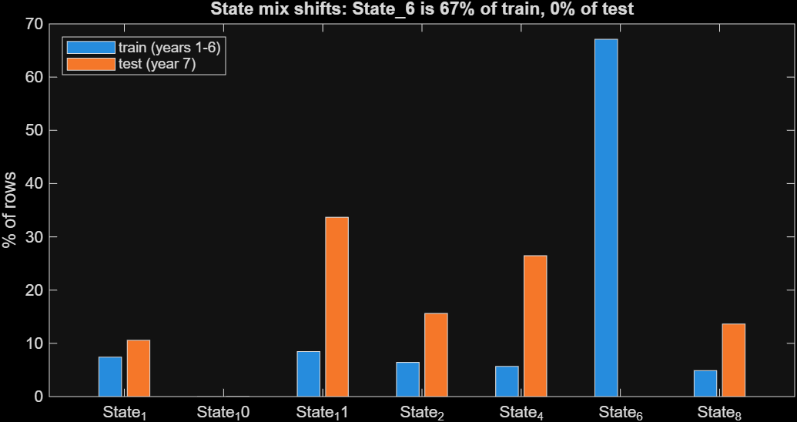
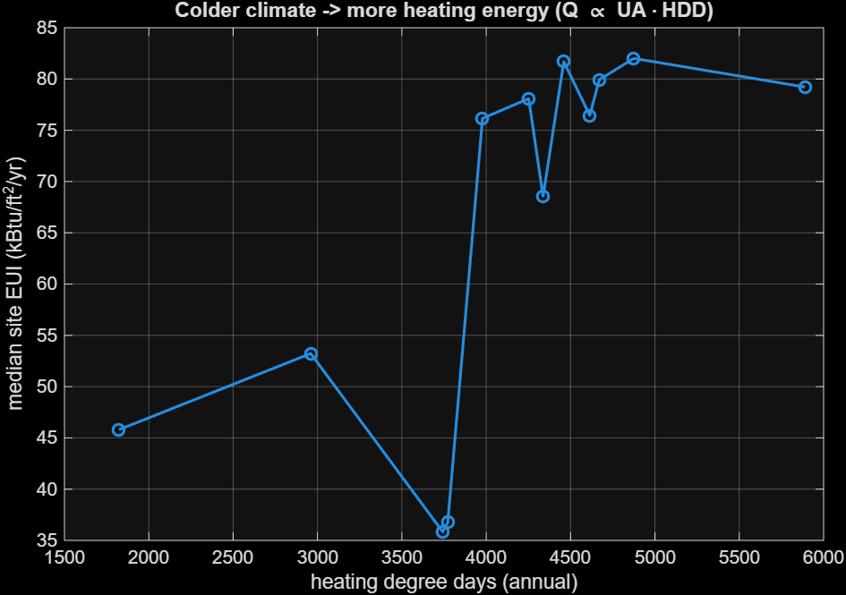
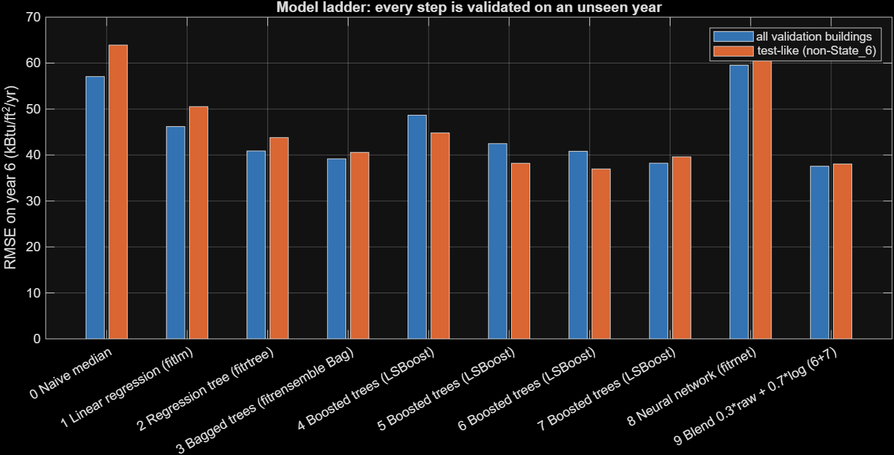
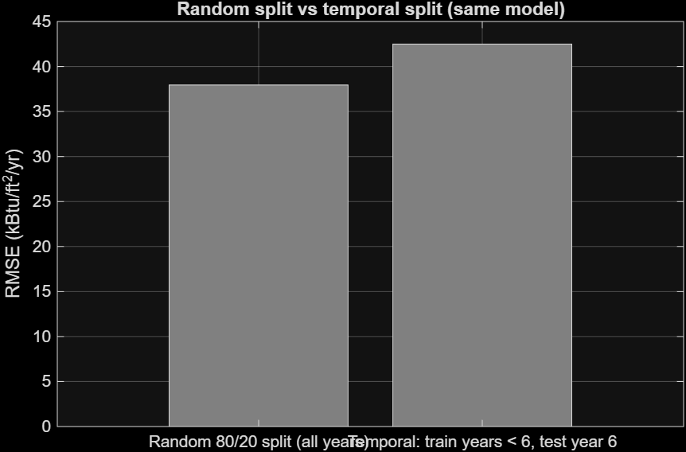
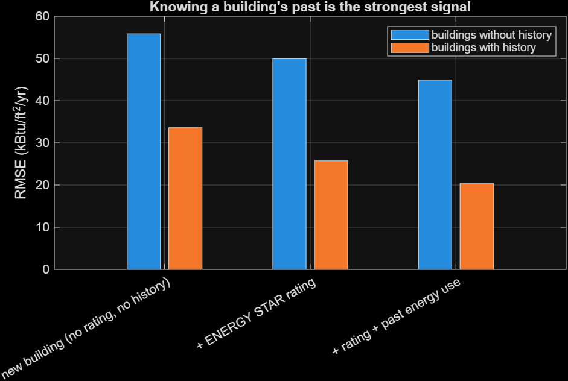
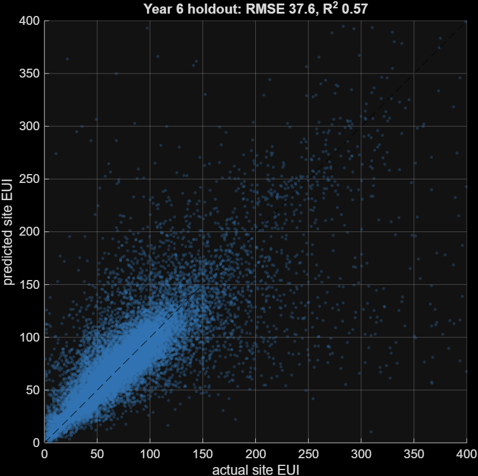
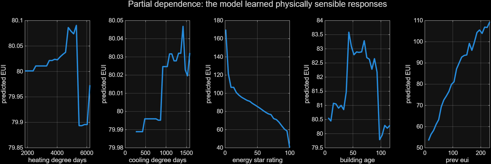
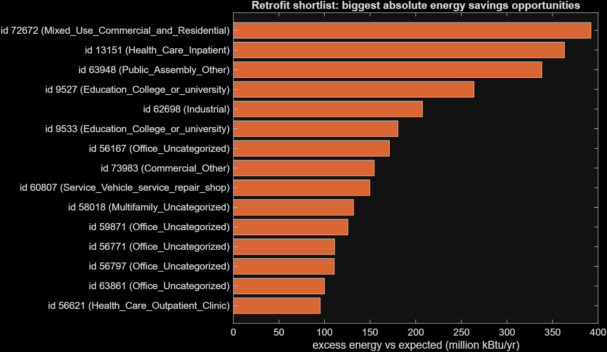

# Which buildings waste energy? Predicting building energy use with MATLAB

**NTU "Learn to Hack: MATLAB Edition 2026" — Predicting Building Energy Consumption**

[](https://matlab.mathworks.com/open/github/v1?repo=JoshiiWahWah/ntu-matlab-hackathon-2026)

We predict a building's annual **site Energy Use Intensity** (EUI, kBtu/ft²/yr) from its
characteristics and local weather (WiDS Datathon 2022, ~76k building-years). The
pipeline is validated on a future year the model has never seen, and then used to
produce a **retrofit shortlist**: buildings using far more energy than physics and
peers say they should.

One command runs everything: `main` (or `main(true)` for a 1–2 minute smoke test).

---

## Why this is more than the starter code

| Starter script | Our pipeline | Why it matters |
|---|---|---|
| Drops all text columns | Keeps `facility_type`, `building_class`, `State_Factor` as **categorical** predictors | Building use is the #1 driver of EUI (fig. 4) |
| Drops every column with a missing value | Missingness **indicators** + model-appropriate handling (trees use NaN natively, linear/NN get train-only medians) | Whether a building has an ENERGY STAR rating is itself informative |
| Random 80/20 split | **Temporal split**: train on years 1–5, validate on year 6 (the test set is year 7) | Mirrors the real forecasting task; random splits let the same building leak across years |
| One model from the app | A **10-rung model ladder**, each rung answering one question | Justifies every algorithm choice with numbers |
| — | **Reconstructed building identity** + causal history features | Past energy use is the strongest predictor — computed only from earlier years |
| — | **Retrofit shortlist** from an out-of-sample cold-start model | Turns predictions into an action |

## What we found in the data (Data Mastery)

All decisions and their evidence are written by `cleanData.m` to
[`results/decisions.csv`](results/decisions.csv).

1. **Distribution shift between train and test.** State_6 makes up 67.1% of training
   rows but **none of the test rows**. So we report a second, **test-like** validation score
   on non-State_6 buildings (fig. 2).
2. **Wind and fog columns are unreliable.** They are 56.0% missing in train and
   89.8% missing in test. A model would learn a missingness pattern that doesn't exist at
   test time, so we drop them.
3. **`year_built = 0`** (7 rows) is not a real year. We set it to missing.
4. **ENERGY STAR rating is 35.3% missing in train (23.2% in test).** We add an `esr_missing` flag before any imputation.
   The rating is itself derived from measured energy use, so we report models with and without it.
5. **Rare facility types** (fewer than 50 training rows: 14 of 60 types, 330 rows) are pooled into `Other_rare`.
6. **The target is right-skewed** (fig. 1), so we train both raw-scale and log-scale models
   and blend them. Extreme EUIs (labs, data centres) are kept because the metric includes them.
7. **The same buildings recur across years**, but no building id is given. We reconstruct
   one (63,907 buildings; 22.1% of test rows have past energy data) from static attributes (state, class, type, floor area, year built, elevation).
   The building's **previous-year EUI** is then a feature. It is computed strictly from
   earlier years, and a unit test (`tests/PipelineTest.m`) proves that.

## Physics-informed features

A building's heating energy follows an energy balance, *Q ≈ UA · ΔT* summed over
the year, so heating demand scales with **heating degree days** and cooling demand
with **cooling degree days**. We add:

- winter and summer mean temperatures
- annual temperature range
- total degree days and the cooling share
- log floor area
- relative building age

In the raw data (fig. 5), median EUI is about 36–53 kBtu/ft²/yr below ~3,800 heating degree
days and about 68–82 above 4,000. Partial dependence (fig. 11) shows clean, monotone
responses to ENERGY STAR rating (higher score → lower EUI) and previous-year EUI. The
model's own HDD/CDD curves are nearly flat (±0.1 kBtu/ft²/yr). Weather is recorded per
state and year, so once State_Factor, facility type and history are known, the degree-day
features add little on top. We report this rather than claim a climate effect the model
doesn't use.

## Model ladder (Use of ML)

Validation = Year_Factor 6, trained on years 1–5. RMSE in kBtu/ft²/yr (official WiDS metric).

| # | Model (MATLAB function) | Features | Target | RMSE | Test-like RMSE¹ | Buildings with history | New buildings |
|---|---|---|---|---|---|---|---|
| 0 | Naive median | – | raw | 57.07 | 63.92 | 49.42 | 61.24 |
| 1 | Linear regression (`fitlm`) | physics-linear | log | 46.19 | 50.54 | 38.60 | 50.23 |
| 2 | Regression tree (`fitrtree`) | full | raw | 40.89 | 43.81 | 26.64 | 47.47 |
| 3 | Bagged trees (`fitrensemble` Bag) | full | raw | 39.17 | 40.57 | 23.19 | 46.23 |
| 4 | Boosted trees (`fitrensemble` LSBoost) | cold start² | raw | 48.67 | 44.82 | 33.61 | 55.84 |
| 5 | Boosted trees | + ENERGY STAR | raw | 42.49 | 38.21 | 25.75 | 49.96 |
| 6 | Boosted trees | + building history | raw | 40.81 | **36.97** | 21.65 | 48.87 |
| 7 | Boosted trees | + building history | log | 38.23 | 39.61 | 20.97 | 45.59 |
| 8 | Neural network (`fitrnet`) | full | log | 59.55 | 60.73 | 44.99 | 66.83 |
| **9** | **Blend 0.3·raw + 0.7·log (6 + 7)** | full | blend | **37.56** | 38.06 | **20.32** | **44.88** |

¹ Non-State_6 buildings. State_6 is absent from the test set, so this subset resembles it most.
² No ENERGY STAR rating and no energy history: the honest model for a brand-new building.

**Final model (submitted):** blend 9, retrained on all six labelled years.
RMSE **37.56** vs 57.07 naive (**−34.2%**), MAE 17.32, R² 0.566. The blend weight was
picked on the validation year.

**What the ladder taught us**
- **Non-linearity matters.** One tree beats linear regression (40.9 vs 46.2), because
  energy use depends on interactions such as facility type × climate.
- **The ENERGY STAR rating helps** (48.7 → 42.5). It is derived from measured energy,
  though, so we keep a cold-start model for new buildings.
- **A building's own history is the strongest signal.** Buildings with past data drop to
  RMSE 20.3, against 44.9 for buildings without.
- **Log and raw targets are complementary.** Log is better overall, raw is better on
  test-like buildings, and blending gets the best of both.
- **The neural net underperformed** (59.5) on this tabular data with heavy missingness,
  even with standardisation and regularisation. We report it rather than hide it.
- **A MATLAB-specific lesson.** Without surrogate splits, a MATLAB tree stops rows that
  are missing the split variable at that node. Our first full run therefore barely learned
  from buildings without a rating or history (blend RMSE 46.8). Encoding missing values as
  an out-of-range sentinel (`src/treeInputs.m`) fixed it: 46.8 → 37.6.

**Why validation design matters.** Same model, same features:

| Validation scheme | RMSE |
|---|---|
| Random 80/20 split (all years) | 37.95 |
| Temporal: train years 1–5, test year 6 | 42.49 |

The random split looks about 12% better because other years of the same building leak into
training. We report the temporal number.

**What drives energy use** (boosted-tree importance): facility type, ENERGY STAR rating,
previous-year EUI, floor area, mean past EUI, year built, state.

## Retrofit shortlist (the "so what")

The **cold-start** model (no rating, no history) is trained on earlier years and estimates
what a typical building of the same type, size, age and climate uses. A building's excess
EUI is its actual EUI minus that prediction. Candidates are the top 5% by excess within
each facility type, ranked by **excess energy = excess EUI × floor area**. That ranking puts
the biggest absolute savings first.

**Result:** **1,123 buildings** in year 6 together use **1.55 × 10¹⁰ kBtu/yr more** than
expected. That is **5.3% of all energy** used by the year-6 buildings, concentrated in about 5% of them. See [`results/retrofit_top20.csv`](results/retrofit_top20.csv) and fig. 12.

## Key figures

| | |
|---|---|
|  |  |
|  |  |
|  |  |
|  |  |

All 12 figures are in [`figures/`](figures/). The demo script is [`docs/DEMO_SCRIPT.md`](docs/DEMO_SCRIPT.md).

## How to run

1. Put `train.csv` and `test.csv` in `data/` (see [`data/README.md`](data/README.md)).
2. In MATLAB (R2022a or newer, Statistics and Machine Learning Toolbox), from the repo root:
   ```matlab
   main(true)                 % quick smoke test (~1-2 min)
   main                       % full run: results/, figures/, results/submission.csv
   results = runtests('tests')
   publish('report/report.m', 'outputDir', 'report', 'format', 'html')
   ```

## Repository layout

```
main.m              end-to-end pipeline (one command)
config.m            all settings in one place (seed 42, model hyperparameters, QUICK mode)
src/                loadData, cleanData, makeFeatures, splitData, runModelLadder,
                    fitBoost, compareValidation, explainModel, retrofitAnalysis,
                    makeEdaFigures, makeResultFigures, validateSubmission, ...
tests/              matlab.unittest tests (metrics, causal history, submission validator)
report/report.m     publishable results report
results/            model ladder, decisions log, retrofit list, submission.csv
figures/            all figures (PNG)
docs/               demo script and Devpost write-up
```

## AI-assistance disclosure

Code was drafted with Claude Code (Anthropic). All results come from running the MATLAB
code, and the team reviewed the design decisions. Python was used only for an early
offline sanity check of data facts; it is not part of the submission.
